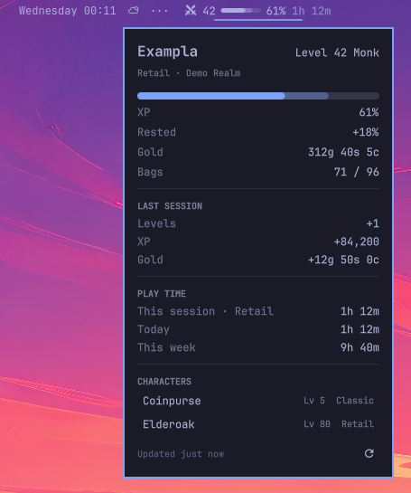

# WoW Character Card

Your World of Warcraft character in the Omarchy bar: level, XP, gold, bags and
time played.



Works with Retail, Classic and WoW Forever, under any launcher that runs the
game through Wine or Proton.

This is an unofficial community plugin. It is not affiliated with or endorsed
by Blizzard Entertainment. World of Warcraft is a trademark of Blizzard
Entertainment, Inc.

## What it shows

- **In the bar:** level and XP bar for the character you played last, with a
  session clock while the game is running.
- **In the panel:** gold, bags, rested XP, what you gained last session, time
  played today and this week, and your other characters.

## How it works

WoW has no live link to the desktop. A small companion addon records your
character, and the game saves that record when you log out or type `/reload`.
So the card is a snapshot from your last logout or reload. The session clock
is live, because it comes from watching the game process.

Nothing is sent anywhere. The plugin makes no network connections.

## Requirements

- Omarchy with the Quickshell-based shell
- `jq` (part of a standard Omarchy install)

## Install

```bash
omarchy plugin add https://github.com/sharpmonk/omarchy-wow-character-card.git --enable
```

Then:

1. Launch WoW once. The plugin finds the install from the running game.
2. Click the widget and press **Install addon**.
3. Restart WoW if it was open, log in, and log out or type `/reload`.

If the game is not found, press **Search for WoW** in the panel, or set
**WoW folder** in the widget's settings to the folder that holds `_retail_` or
`_classic_`.

## Settings

| Setting | What it does |
|---|---|
| WoW folder | Where WoW is installed. Leave blank to have it found for you |
| Bar face | Full, Compact, or Auto. Auto uses Compact on a narrow or upright monitor |
| Show session clock in the bar | Shows the session length while you play |
| Show XP percentage in the bar | Shows the figure next to the XP bar |
| Characters to hide | Names, separated by commas, to leave out |

The compact face shows the icon, level and XP bar. The percentage and clock
are still in the panel.

## Remove

```bash
omarchy plugin remove sharpmonk.wow-character-card
```

The plugin leaves two things behind. Remove them by hand if you want them gone:

1. The addon: delete the `WoWCharacterCard` folder from `Interface/AddOns`
   in each WoW version folder.
2. The play-time log: `rm -r ~/.local/state/wow-character-card`

## Files it writes

| Where | What |
|---|---|
| `~/.local/state/wow-character-card/` | Play-time log, known installs, last good character data |
| `<WoW>/Interface/AddOns/WoWCharacterCard/` | The addon, only when you press Install or Update |
| `<WoW>/WTF/Account/<account>/SavedVariables/WoWCharacterCard.lua` | Written by the game itself |

## Development

```bash
tests/run.sh
```

The tests need `lua5.1` (Arch package `lua51`) and `jq`. They use made-up
folders and never touch a real WoW install.

To see the widget with made-up characters, for screenshots:

```bash
omarchy-shell sharpmonk.wow-character-card.service demo true
```

## Licence

MIT. See [LICENSE](LICENSE).
